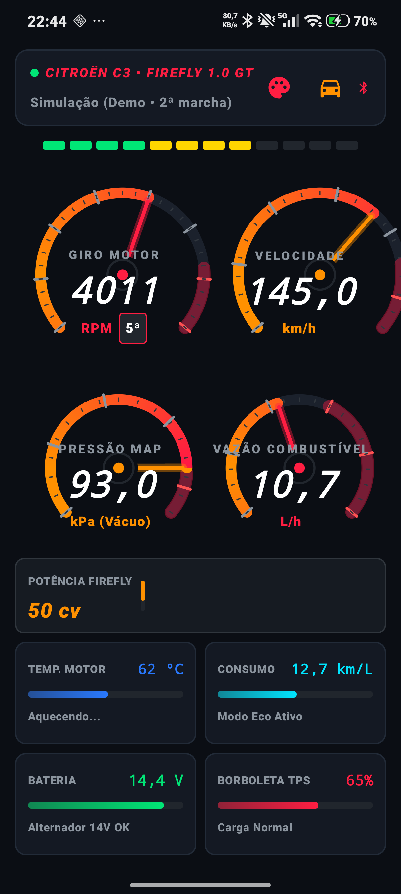
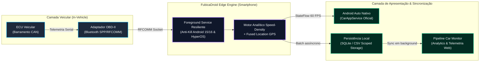

# FubicaDroid — Telemetria Veicular Edge-to-Cloud, Android Auto Nativo & Modelagem Termodinâmica

<p align="center">
  
  
  
  
  
  
  
</p>

---

## 📸 Evidências Visuais do Produto (Cockpit & Projeção Veicular)

<div align="center">
  <table>
    <tr>
      <th width="33%">HUD Esportivo (60 FPS Canvas)</th>
      <th width="33%">Projeção Nativa Android Auto</th>
      <th width="33%">Modo Espelho HUD Noturno</th>
    </tr>
    <tr>
      <td align="center">
        
        <br />
        <sub><i>Mostradores esportivos em Jetpack Compose Canvas desacoplados da thread serial, operando a 60 FPS com marchas calculadas da caixa de câmbio.</i></sub>
      </td>
      <td align="center">
        
        <br />
        <sub><i>Interface veicular oficial via CarAppService integrada à central multimídia de 10" com cartões Extended ASCII de baixa distração visual.</i></sub>
      </td>
      <td align="center">
        
        <br />
        <sub><i>Inversão geométrica de matriz ótica com paleta de alto contraste para reflexão nítida diretamente no para-brisa.</i></sub>
      </td>
    </tr>
  </table>
</div>

---

## 🏛️ Visão Executiva & Arquitetura End-to-End

O **FubicaDroid** é uma plataforma de engenharia de software automotivo e computação de borda (*Edge Computing*). Ele transforma um smartphone Android padrão em um computador de telemetria avançada de alta precisão, operando como ponte em tempo real entre o barramento CAN do veículo, o ecossistema Android Auto e pipelines de análise de dados em nuvem.

### Fluxo de Dados e Componentes da Solução



---

## ⚙️ Desafios de Engenharia Resolvidos (O Valor Arquitetural)

### 1. Estimativa de Consumo e Potência sem Sensor MAF Físico
* **O Problema:** Motores modernos de downsizing aspirados da plataforma Stellantis GSE Firefly eliminam fisicamente o sensor MAF (*Mass Air Flow*) para redução de custos e restrição aerodinâmica de admissão. Scanners universais falham ao retornar leituras zeradas para vazão e consumo instantâneo.
* **A Solução:** Implementação de um **Motor de Inferência Física Speed-Density** executado na borda. A partir da Lei dos Gases Ideais combinada com a dinâmica da rotação ($RPM$), pressão no coletor ($MAP$), temperatura admitida ($IAT$) e da superfície volumétrica de respiração do motor ($VE$), o sistema infere o fluxo mássico de ar ($\dot{m}_{air}$) e calcula com rigor termodinâmico o consumo instantâneo ($km/L$), vazão horária ($L/h$) e potência indicada em cavalos ($cv$).
* 📘 *Detalhamento conceitual:* [docs/SPEED_DENSITY_MODEL.md](docs/SPEED_DENSITY_MODEL.md)

### 2. Integração Oficial Android Auto (`androidx.car.app`)
* **O Problema:** Aplicativos tradicionais de telemetria exigem acesso root, hacks de espelhamento não-oficiais (AA Mirror, Screen2Auto) ou limitam-se à tela minúscula do smartphone presa em suportes de ventosa.
* **A Solução:** Arquitetura 100% nativa utilizando a biblioteca oficial **Android for Cars App Library** (`CarAppService` e `Session`). A interface é construída sobre templates veiculares otimizados para redução de distração ao volante (*Driver Distraction Guidelines*), projetando cartões retangulares de alto contraste com bargraphs de estilete em qualquer central multimídia homologada (ex.: tela touchscreen de 10" do Citroën ConnectPlay).
* 📘 *Decisões de projeto:* [docs/ARCHITECTURE.md](docs/ARCHITECTURE.md)

### 3. Resiliência em Background & Scoped Storage (Android 15/16 & HyperOS)
* **O Problema:** Políticas severas de gerenciamento de bateria de fabricantes (como Xiaomi HyperOS, Samsung OneUI e versões recentes do Android) encerram conexões seriais RFCOMM arbitrariamente quando o aplicativo entra em background ou a tela do aparelho desliga.
* **A Solução:** Estruturação de `ForegroundService` com declaração multi-tipo (`connectedDevice` e `location`), gerenciamento cirúrgico de `WakeLock`, orquestração por eventos de hardware (`BluetoothDevice.ACTION_ACL_CONNECTED`) sem polling desnecessário de CPU, e persistência em buffer local SQLite com Scoped Storage isolado, garantindo tracking ininterrupto em trajetos de centenas de quilômetros.
* 📘 *Aplicações de frota e oficina:* [docs/B2B_USE_CASES.md](docs/B2B_USE_CASES.md)

---

## 📁 Estrutura da Documentação do Repositório

```text
├── README.md                  # Vitrine executiva, evidências visuais e arquitetura da solução
├── LICENSE                    # Aviso de direitos autorais e política Open Architecture, Closed Core
├── docs/
│   ├── ARCHITECTURE.md        # Especificação detalhada de software embarcado, threads e resiliência
│   ├── SPEED_DENSITY_MODEL.md # Fundamentação matemática da mecânica dos fluidos e termodinâmica
│   └── B2B_USE_CASES.md       # Oportunidades comerciais para frotas comerciais leves e oficinas
└── assets/                    # Artefatos visuais e evidências de execução veicular
    ├── hud-day.png
    ├── hud-night-mirror.png
    └── android-auto-connectplay.png
```

---

## 🛡️ Propriedade Intelectual & Licenciamento Restritivo

> **Aviso de Propriedade Intelectual:**  
> Este repositório é uma **Vitrine Arquitetural Pública (*Open Architecture, Closed Core*)** destinada exclusivamente a fins de portfólio executivo, avaliação arquitetural de alto nível e demonstração técnica.  
> 
> O código-fonte compilável do *core*, os drivers seriais de baixo nível, os mapas 3D proprietários de eficiência volumétrica ($VE$), as constantes de calibração veicular e as chaves de integração corporativa pertencem exclusivamente a **Anderson RGS** sob reserva total de direitos autorais ([LICENSE](LICENSE)). É expressamente vedada a reprodução, engenharia reversa ou exploração comercial sem autorização prévia por escrito.

* **Autor / Arquiteto da Solução:** Anderson RGS
* **Contato Corporativo:** `andersonrgs@gmail.com`
* **Dashboard de Telemetria:** [https://andersonrgs.github.io/Car_dashboard/](https://andersonrgs.github.io/Car_dashboard/)
