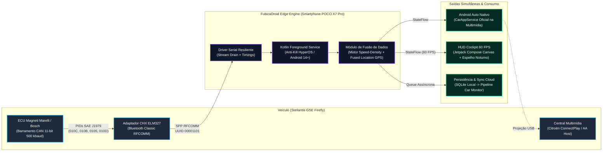
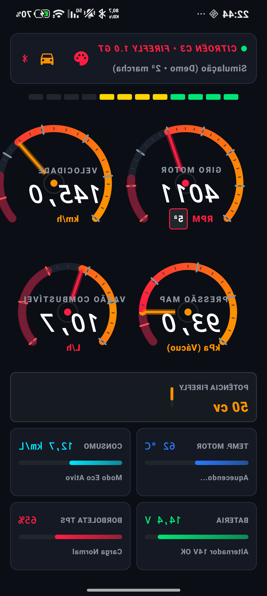
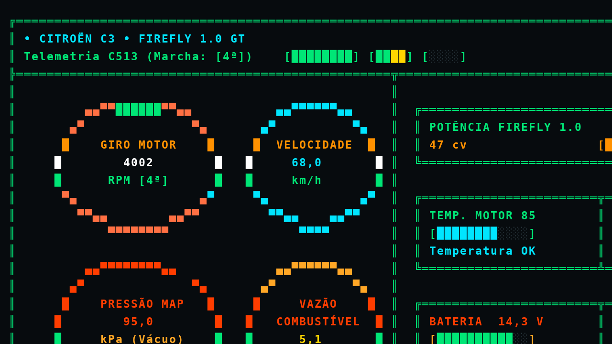

# FubicaDroid — Telemetria Automotiva & Motor Speed-Density em Tempo Real

  
  
  
  
  
  

---

## 📌 Resumo Executivo

O **FubicaDroid** é uma solução de engenharia de software embarcado e telemetria automotiva de borda (*Edge Computing*), desenvolvida para preencher a lacuna deixada por aplicativos genéricos de diagnóstico (como Torque Pro e Car Scanner).

### O Problema
1. **Ausência de Sensor MAF Físico:** Motores modernos de três cilindros e alta eficiência térmica — como a família **Stellantis GSE Firefly 1.0 (Citroën C3, Fiat Argo, Mobi, Cronos e Nova Strada)** — não possuem sensor físico de fluxo de ar (*Mass Air Flow - MAF*). Scanners genéricos retornam leituras nulas (`NO DATA` no PID `0110`), resultando em consumo instantâneo zerado ou aproximações imprecisas.
2. **Alta Latência e Falta de Integração Nativa:** Aplicativos convencionais operam com interfaces legadas, latência perceptual perceptível e não possuem integração nativa com a tela do painel do veículo via Android Auto oficial.
3. **Morte de Processos em Segundo Plano:** Camadas agressivas de gerenciamento de energia como o **Xiaomi HyperOS** e **Android 14+** encerram conexões seriais Bluetooth arbitrariamente quando a tela do celular é bloqueada.

### A Solução FubicaDroid
O **FubicaDroid** embarca um **Motor de Inferência Física Speed-Density** executado no próprio dispositivo, que deriva o fluxo mássico de ar ($\dot{m}_{air}$) através das leis dos gases ideais e da pressão no coletor (MAP), projetando mostradores esportivos em tempo real tanto no smartphone (a 60 FPS com Jetpack Compose) quanto na central multimídia original do veículo via **Android Auto CarAppService**, com sincronização em nuvem resiliente para o ecossistema [Car Monitor](https://andersonrgs.github.io/Car_dashboard/).

---

## 🏛️ Diagrama de Arquitetura de Alto Nível

---

## 📸 Galeria de Telas & Demonstração Visual

  <table>
    <tr>
      <th width="33%">Cockpit HUD Diurno (Compose)</th>
      <th width="33%">Modo Espelho HUD Noturno</th>
      <th width="33%">Projeção Citroën ConnectPlay</th>
    </tr>
    <tr>
      <td align="center">
        
         
        <i>Mostradores esportivos em Jetpack Compose Canvas a 60 FPS com marchas reais calculadas da caixa C513.</i>
      </td>
      <td align="center">
        
         
        <i>Modo invertido de alto contraste para projeção ótica direta no para-brisa do carro.</i>
      </td>
      <td align="center">
        
         
        <i>Painel oficial via CarAppService com cartões dinâmicos em Extended ASCII (CP437) na tela de 10".</i>
      </td>
    </tr>
  </table>

---

## 📚 Documentação Técnica Aprofundada

Explore os documentos de arquitetura e fundamentação técnica:

* 📐 [**ARCHITECTURE.md**](docs/ARCHITECTURE.md) — Engenharia de software embarcado, resiliência contra fechamento em segundo plano no Xiaomi HyperOS / Android 14+, ciclo de vida do `CarAppService` e tratamento de transceptor serial clone.
* ⚡ [**SPEED_DENSITY_MODEL.md**](docs/SPEED_DENSITY_MODEL.md) — Fundamentação matemática e termodinâmica do modelo *Speed-Density*, estimativa de fluxo mássico ($\dot{m}_{air}$), vazão de combustível ($L/h$), cut-off e potência estimada sem sensor MAF.
* 💼 [**B2B_USE_CASES.md**](docs/B2B_USE_CASES.md) — Aplicações comerciais para frotas comerciais leves da plataforma Stellantis (Strada, Fiorino, Mobi, C3) e triagem expressa de 60 segundos na recepção de oficinas mecânicas.

---

## 🛡️ Propriedade Intelectual & Modelo de Licenciamento

> **Modelo: Open Architecture, Closed Core**  
> Este repositório disponibiliza publicamente a **arquitetura de alto nível, especificações técnicas e modelos conceituais de engenharia**.  
> O código-fonte integral, drivers seriais de baixo nível, matrizes 3D calibradas de eficiência volumétrica ($VE$), tabelas de avanço e rotinas proprietárias de sincronização permanecem sob **segredo comercial e direitos autorais reservados** conforme estabelecido no arquivo [LICENSE](LICENSE).

Para parcerias corporativas, licenciamento de SDK embarcado (*white-label*) ou avaliações de código sob **Acordo de Confidencialidade (NDA)**:

* 👤 **Engenheiro Líder:** Anderson RGS
* 📧 **Contato:** `andersonrgs@gmail.com`
* 🌐 **Plataforma Web de Telemetria:** [Car Monitor Dashboard](https://andersonrgs.github.io/Car_dashboard/)
